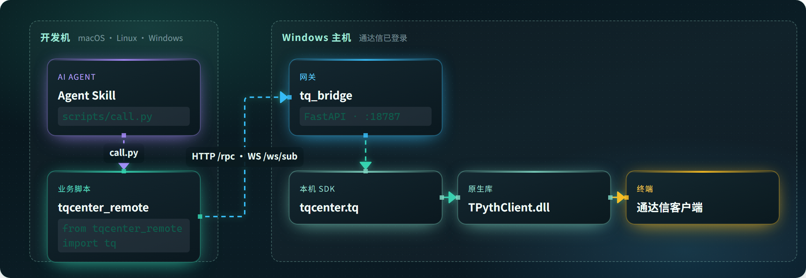

# tq-bridge

[](https://atorber.github.io/tq-bridge/guide/architecture)

通达信 `tqcenter` 跨平台远程调用方案：在一台已登录通达信的 Windows 机器上运行网关，其它电脑（Windows / macOS / Linux）用几乎相同的 Python API 取数。

官网：https://atorber.github.io/tq-bridge/  
通达信背景与官方资料：[用户红宝书](https://help.tdx.com.cn/book.html) · [TdxQuant 接口文档（本站在线）](https://atorber.github.io/tq-bridge/guide/tdxquant-doc) · [通达信背景知识](https://atorber.github.io/tq-bridge/guide/tdx-background)

```bash
pip install tq-bridge
```

### Agent Skill（一句话安装）

让各类 Agent（Cursor / Claude Code / Codex 等）直接调用远程 `tqcenter` 全套接口：

```bash
npx skills add atorber/tq-bridge --skill tqcenter_remote -a '*' -g -y
```

- `-a '*'`：安装到本机已支持的全部 Agent
- `-g`：用户级全局（各 Agent 用户目录）；去掉则装到当前项目
- `-y`：跳过确认

安装后还需：本机 `pip install tq-bridge`、配置 `TQ_BRIDGE_URL`（或 `tq_bridge.json`），且 Windows 网关在线。用法见官网 [Agent Skill](https://atorber.github.io/tq-bridge/guide/skill) 或仓库 `skills/tqcenter_remote/SKILL.md`。

发布到 PyPI：在 GitHub 创建 Release（或手动跑 **Publish to PyPI** Action）。首次需在 PyPI 项目启用 Trusted Publisher（GitHub：`atorber/tq-bridge`，workflow：`publish-pypi.yml`，environment：`pypi`）。

## 架构

```
业务脚本
  from tqcenter_remote import tq
        │
        │  HTTP /rpc  +  WebSocket /ws/sub
        ▼
Windows: tq_bridge (FastAPI)
        │
        ▼
本机 tqcenter.tq  →  TPythClient.dll  →  通达信客户端
```

| 组件 | 说明 |
|------|------|
| `tq_bridge/` | Windows 网关：包装真实 `tqcenter`，对外提供 HTTP / WebSocket |
| `tqcenter_remote/` | [Python SDK](https://atorber.github.io/tq-bridge/api/python-sdk)；其它语言可按[网关协议](https://atorber.github.io/tq-bridge/api/gateway-http)自研 |
| `tqcenter.py` | 官方本机 SDK（仅 Windows + 通达信客户端） |
| `tqserver.py` | 云端 TdxAiData 封装（与本方案独立） |
| `tdxdata_test.py` | 官方本机用法示例 |
| `tdxdata_test_remote.py` | 远程 SDK 冒烟示例 |

业务侧只需改包名：

```python
# 本机（Windows + 已登录通达信）
from tqcenter import tq, tqconst

# 远程（任意平台，需网关在线）
from tqcenter_remote import tq, tqconst
```

---

## 一、Windows 网关（必须先启动）

### 1. 前置条件

1. 安装 64 位通达信，并**保持客户端登录**。
2. 本仓库放在可导入官方 SDK 的位置，例如通达信目录下的 `PYPlugins/user/`，保证能执行：

```python
from tqcenter import tq
```

3. Python 3.9+（与通达信插件环境一致即可），建议 64 位。

### 2. 安装依赖

推荐：

```bat
pip install tq-bridge
```

或从源码安装网关依赖：

```bat
pip install -r tq_bridge\requirements.txt
```

### 3. 配置环境变量

| 变量 | 必填 | 默认 | 说明 |
|------|------|------|------|
| `TQ_BRIDGE_TOKEN` | 建议 | 空（不鉴权） | Bearer Token，局域网也建议设置 |
| `TQ_BRIDGE_HOST` | 否 | `0.0.0.0` | 监听地址 |
| `TQ_BRIDGE_PORT` | 否 | `18787` | 监听端口 |
| `TQ_BRIDGE_INIT_PATH` | 否 | 网关自身路径 | 传给 `tq.initialize(path)` 的路径 |
| `TQ_BRIDGE_ALLOW_TRADE` | 否 | `1` | 设为 `0` 禁用下单/撤单 |

示例（cmd）：

```bat
cd /d c:\new_tdx64\PYPlugins\user
set TQ_BRIDGE_TOKEN=your_secret
set TQ_BRIDGE_PORT=18787
set TQ_BRIDGE_INIT_PATH=%CD%\tdxdata_test.py
set TQ_BRIDGE_ALLOW_TRADE=0
python -m tq_bridge
```

PowerShell：

```powershell
$env:TQ_BRIDGE_TOKEN="your_secret"
$env:TQ_BRIDGE_PORT="18787"
$env:TQ_BRIDGE_INIT_PATH="$PWD\tdxdata_test.py"
$env:TQ_BRIDGE_ALLOW_TRADE="0"
python -m tq_bridge
```

启动成功后终端会打印监听地址；同时放行防火墙入站 TCP（默认 `18787`）。

### 4. 健康检查

浏览器或命令行访问：

```text
http://<windows-ip>:18787/health
```

正常时大致返回：

```json
{
  "ok": true,
  "initialized": true,
  "run_id": 1,
  "allow_trade": false
}
```

`ok=false` 时优先检查：通达信是否登录、`tqcenter` 能否本机初始化、`TQ_BRIDGE_INIT_PATH` 是否有效。

---

## 二、远程客户端（Windows / macOS / Linux）

### 1. 安装依赖

```bash
pip install tq-bridge
# 或：pip install -r tqcenter_remote/requirements.txt
```

主要依赖：`pandas`、`websocket-client`（行情订阅需要）；网关另需 FastAPI / uvicorn。

### 2. 配置网关地址

任选一种方式（优先级：环境变量 > 配置文件）。

**方式 A：环境变量**

```bash
# macOS / Linux
export TQ_BRIDGE_URL=http://192.168.1.100:18787
export TQ_BRIDGE_TOKEN=your_secret
```

```bat
REM Windows
set TQ_BRIDGE_URL=http://192.168.1.100:18787
set TQ_BRIDGE_TOKEN=your_secret
```

**方式 B：配置文件 `tq_bridge.json`**

可放在：脚本同目录、当前工作目录、用户目录 `~/.tq_bridge.json`、或 `tqcenter_remote/` 包目录。

```json
{
  "url": "http://192.168.1.100:18787",
  "token": "your_secret"
}
```

可参考：`tqcenter_remote/tq_bridge.json.example`。

### 3. 最小示例

```python
from tqcenter_remote import tq, tqconst

tq.initialize(__file__)  # 签名与官方一致；实际读取网关配置

df = tq.get_market_data(
    field_list=[],
    stock_list=["688318.SH", "600519.SH"],
    start_time="20250101",
    end_time="",
    count=5,
    dividend_type="front",  # none / front / back
    period="1d",
    fill_data=True,
)
print(df)

snap = tq.get_market_snapshot(stock_code="688318.SH", field_list=[])
print(snap)

tq.close()
```

一键冒烟：

```bash
python tdxdata_test_remote.py
```

---

## 三、常用接口示例

下列写法与官方 `tqcenter` / `tdxdata_test.py` 保持一致，远程侧只改 import。

### K 线

```python
df = tq.get_market_data(
    stock_list=["688318.SH"],
    period="1d",          # 1m / 5m / 15m / 30m / 1h / 1d / 1w ...
    count=100,
    dividend_type="front",
)
```

### 快照 / 基础信息

```python
tq.refresh_cache(force=True)
snap = tq.get_market_snapshot(stock_code="688318.SH")
info = tq.get_stock_info(stock_code="688318.SH")
```

### 财务 / 板块

```python
fd = tq.get_financial_data(
    stock_list=["688318.SH"],
    start_time="20230101",
    end_time="",
    report_type="report_time",
)

sectors = tq.get_sector_list(list_type=1)
stocks = tq.get_stock_list_in_sector("880201.SH")
```

### 订阅行情（WebSocket）

```python
def on_hq(data_str: str):
    print("hq:", data_str[:200])

tq.subscribe_hq(stock_list=["688318.SH"], callback=on_hq)
print(tq.get_subscribe_hq_stock_list())

# ...
tq.unsubscribe_hq(stock_list=["688318.SH"])
```

> 订阅依赖客户端已安装 `websocket-client`，且网关 WebSocket `/ws/sub` 可达。

### 文件类接口

- `tq.send_file(path)`：远程会把本地文件上传到 Windows 临时目录，再交给通达信。
- `tq.print_to_tdx(...)`：结果写在 **Windows 通达信目录**，不是客户端本机目录。
- `tq.download_file(...)`：走网关转发官方下载逻辑。

### 交易类（默认可用，建议关闭）

```python
# 网关侧建议：set TQ_BRIDGE_ALLOW_TRADE=0
account = tq.stock_account(account="", account_type="STOCK")
# tq.order_stock(...); tq.cancel_order_stock(...)
```

常量与官方一致，例如：

```python
from tqcenter_remote import tqconst
tqconst.STOCK_BUY, tqconst.STOCK_SELL, tqconst.PRICE_SJ
```

---

## 四、两种模式怎么选

| 场景 | 用法 |
|------|------|
| 就在通达信那台 Windows 上跑策略 | `from tqcenter import tq`，参考 `tdxdata_test.py` |
| 在 Mac / Linux / 其它 Windows 上开发 | `from tqcenter_remote import tq` + 常开网关 |
| 只要云端 AI 数据、不依赖本机通达信 | 使用 `tqserver.py` / `tqs`（另一条链路） |

---

## 五、常见问题

1. **`网关未就绪` / `health.ok=false`**  
   通达信未登录、DLL 加载失败、或 `TQ_BRIDGE_INIT_PATH` 无效。先在网关机器上直接 `python -c "from tqcenter import tq; tq.initialize(r'你的路径')"` 验证。

2. **客户端连不上**  
   检查 `TQ_BRIDGE_URL`、防火墙端口、Token 是否一致；可用 `curl http://ip:18787/health` 测连通。

3. **`subscribe_hq` 无回调**  
   确认已安装 `websocket-client`，且初始化后 WebSocket 已连上（客户端日志不应持续报 WS 错误）。

4. **`print_to_tdx` 找不到文件**  
   文件落在 Windows 通达信目录，请到网关那台机器查看。

5. **代码格式**  
   证券代码需带市场后缀，如 `600519.SH`、`000001.SZ`、`688318.SH`。

---

## 六、目录结构

```text
.
├── README.md
├── LICENSE
├── tq_bridge/              # Windows 网关
│   ├── server.py
│   ├── codec.py
│   └── requirements.txt
├── tqcenter_remote/        # 跨平台远程 SDK
│   ├── client.py
│   ├── tqconst.py
│   ├── tq_bridge.json.example
│   └── requirements.txt
├── tqcenter.py             # 官方本机 SDK（参考）
├── tqserver.py             # 云端数据封装（独立）
├── tdxdata_test.py         # 本机示例
├── tdxdata_test_remote.py  # 远程冒烟
├── skills/tqcenter_remote/ # Agent Skill（全 Agent 可用）
└── website/                # VitePress 官网（首页 + docs）
```

更细的网关说明也可看 [tq_bridge/README.md](tq_bridge/README.md)。

## License

MIT（官方 `tqcenter.py` / DLL 仍遵循通达信相关许可与使用条款）
