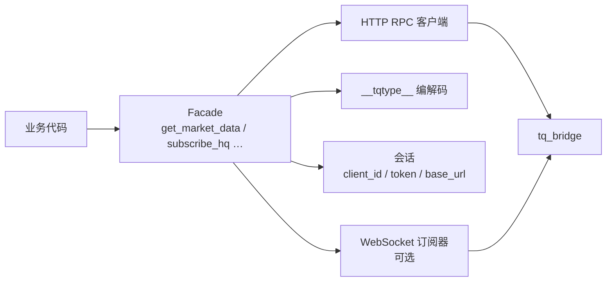
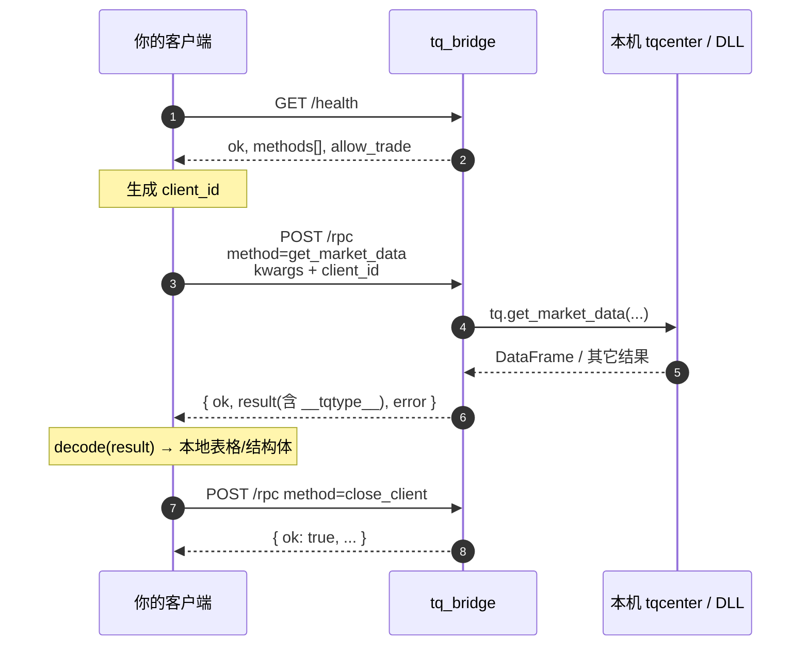
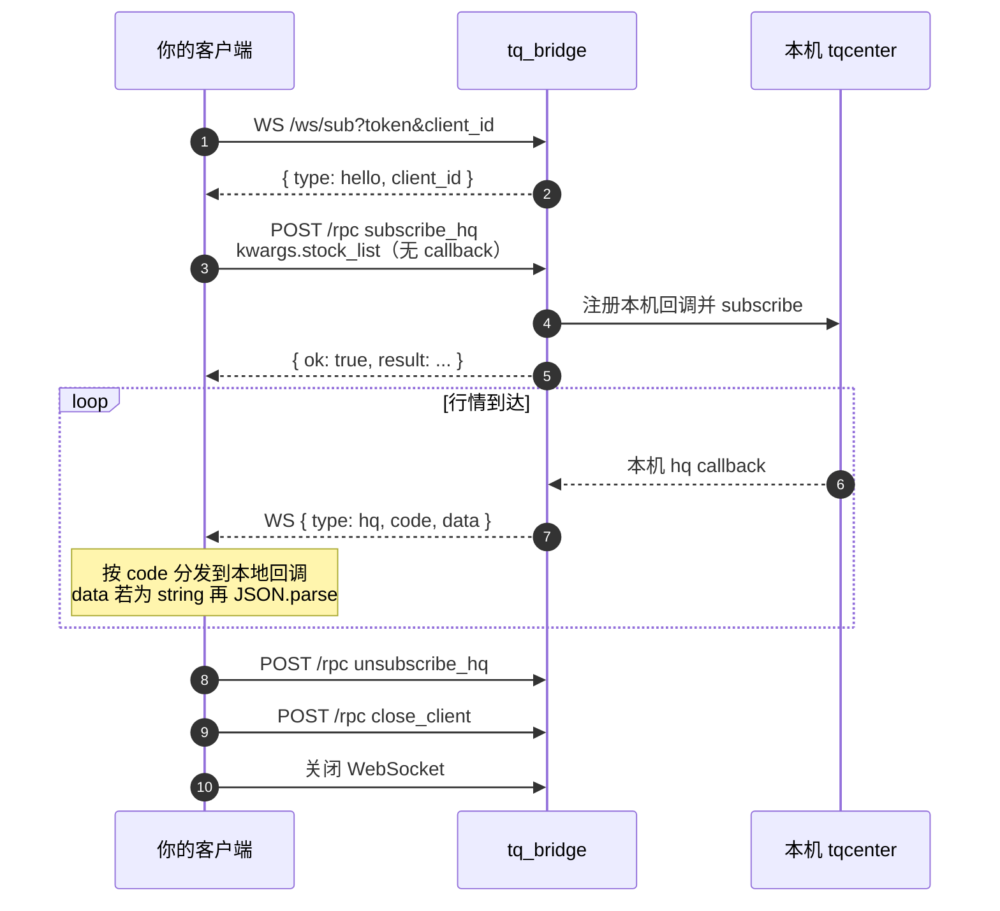
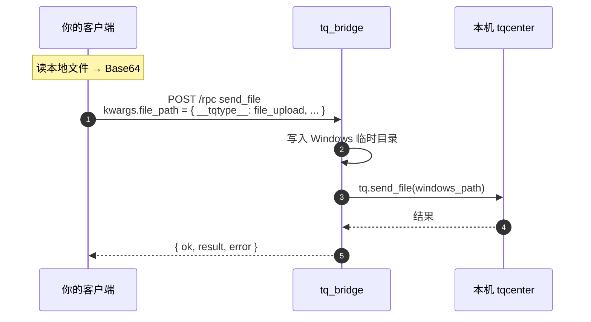

# 网关数据协议

本文是 **语言无关** 的对接规格：任意语言只要实现 **HTTP JSON RPC +（可选）WebSocket 推送**，即可对接 Windows 上的 `tq_bridge`，不必依赖 Python。

| 项 | 说明 |
|----|------|
| 默认基址 | `http://<windows-ip>:18787`（HTTPS 时用 `https` / `wss`） |
| 参考实现 | 仓库 `tqcenter_remote/`（Python） |
| 业务签名 | 与官方 `tqcenter.tq` 对齐，方法名/参数见 [Python SDK](./python-sdk) |

`initialize` / `close`（通达信本机侧）由网关进程管理，**客户端禁止**经 `/rpc` 调用。

---

## 概述：如何自研多语言客户端

目标：在你的语言里做一个薄封装，对外尽量暴露「像 `tq.get_market_data(...)` 一样」的 API，对内只做协议编解码与会话管理。

### 建议模块划分



| 模块 | 职责 | 实现提示 |
|------|------|----------|
| 配置 / 会话 | `base_url`、`token`、生成并持有 `client_id` | UUID；进程内单例或显式 Client 对象均可 |
| HTTP RPC | `POST /rpc`，统一错误处理 | 先看 HTTP 状态，再看 body.`ok` |
| Codec | 请求编码 / 响应解码 `__tqtype__` | 至少支持 `dataframe` / `series` / `bytes_b64` / `file_upload` |
| WebSocket（可选） | 收 `hq`，可选发 subscribe | 与 RPC 共用同一 `client_id` |
| Facade | 把 `method + kwargs` 映射成语言习惯 API | 可按需生成，不必一次实现全部方法 |

### 最小可行路径（MVP）

只做同步取数时，**不必**上 WebSocket：

1. 读配置（URL、Token）
2. `GET /health`，确认 `ok === true`
3. 生成 `client_id`
4. 封装 `rpc(method, kwargs, args)` → `POST /rpc` → 解码 `result`
5. 退出时 `rpc("close_client")`（可省略，但多客户端场景建议调用）

需要实时行情时，再加：连 `/ws/sub` → `subscribe_hq` → 分发 `type=="hq"`。

### 生命周期流程图

```mermaid
flowchart TD
  Start([启动]) --> Health["GET /health"]
  Health -->|ok ≠ true| Fail([失败：网关未就绪])
  Health -->|ok = true| Cid["生成 client_id"]
  Cid --> NeedHq{"需要行情推送?"}
  NeedHq -->|是| WsConn["连接 WS /ws/sub<br/>等待 hello"]
  NeedHq -->|否| Ready([可调用业务 RPC])
  WsConn --> Ready
  Ready --> Loop["循环 POST /rpc<br/>编解码 __tqtype__"]
  Loop --> More{"继续?}
  More -->|是| Loop
  More -->|否| SubOff{"有订阅?"}
  SubOff -->|是| Unsub["unsubscribe_hq"]
  SubOff -->|否| Close
  Unsub --> Close["POST /rpc close_client"]
  Close --> DropWs["关闭 WebSocket"]
  DropWs --> End([结束])
```

### 同步取数时序



### 行情订阅时序

推荐模式与 Python SDK 一致：**HTTP 登记订阅，WebSocket 只收推送**。



也可在 WS 上发 `{ "action": "subscribe_hq", "stock_list": [...] }`，效果等价；见下文 [WebSocket](#websocket-wssub)。

### 文件上传时序（`send_file`）

客户端本地路径在 Windows 网关上无效，须先变成网关可读文件：



也可用独立接口 `POST /files/upload` 拿到 `path`，再把路径字符串传给其它 RPC。

### 通道怎么选

| 通道 | 用途 |
|------|------|
| HTTP `GET /health` | 探活、方法白名单、`allow_trade` |
| HTTP `POST /rpc` | 几乎所有同步取数 / 交易 / 订阅登记 / 文件 |
| HTTP `/files/*` | 显式上传下载（可选） |
| WebSocket `/ws/sub` | 行情推送；也可发订阅指令与 ping |

### 自研检查清单

- [ ] 配置：`base_url`、可选 `token`（HTTP Bearer / WS query）
- [ ] 启动：`GET /health`，`ok` 为真再继续
- [ ] 全程同一 `client_id`（RPC 与 WS）
- [ ] `rpc()`：组装 JSON → 处理 `401`/`503` → 以 body.`ok` 判业务成败 → `decode(result)`
- [ ] Codec：编解码 `__tqtype__`（至少 dataframe）
- [ ] 禁止调用 `initialize` / `close`；退出用 `close_client`
- [ ] （可选）WS：等 `hello` → 订阅 → 处理 `hq` → 心跳 `ping`/`pong`
- [ ] 对照 [Python SDK](./python-sdk) 核对方法名与 kwargs

下文为完整字段与报文约定。

---

## 鉴权

若网关设置了 `TQ_BRIDGE_TOKEN`：

**HTTP**

```http
Authorization: Bearer <token>
Content-Type: application/json
```

未带 Token 或 Token 错误 → `401`。

**WebSocket**

```text
ws://<host>:18787/ws/sub?token=<token>&client_id=<id>
```

Token 错误时连接关闭，关闭码 `4401`。

未设置 Token 时两侧均可不传（仅建议局域网测试）。

---

## `client_id` 会话

- 每个客户端实例应生成稳定唯一的 `client_id`（推荐 UUID hex）。
- 同一 `client_id` 用于：所有 `/rpc` 请求、WebSocket 查询参数。
- 订阅状态按 `client_id` 隔离；断线或调用 `close_client` 后网关注销该会话。

---

## 端点

### `GET /health`

无鉴权要求与其它 HTTP 相同（若启用 Token 则需 Bearer）。

**响应示例**

```json
{
  "ok": true,
  "initialized": true,
  "run_id": 1,
  "error": null,
  "allow_trade": false,
  "methods": ["get_market_data", "get_market_snapshot", "..."]
}
```

| 字段 | 含义 |
|------|------|
| `ok` | 网关已成功初始化本机 `tqcenter` |
| `initialized` | DLL/`tq` 侧初始化标记 |
| `error` | 失败原因字符串，成功时为 `null` |
| `allow_trade` | 是否允许 `order_stock` / `cancel_order_stock` |
| `methods` | 可经 `/rpc` 调用的公开方法名列表（白名单） |

客户端启动流程建议：先 `GET /health`，`ok != true` 则不要发业务 RPC。

---

### `POST /rpc`

核心入口。把「调用 `tq.<method>(*args, **kwargs)`」序列化成 JSON。

**请求**

```json
{
  "method": "get_market_snapshot",
  "args": [],
  "kwargs": {
    "stock_code": "688318.SH",
    "field_list": []
  },
  "client_id": "a1b2c3d4e5f6"
}
```

| 字段 | 类型 | 必填 | 说明 |
|------|------|------|------|
| `method` | string | 是 | 方法名，须在 `/health.methods` 或下文「特殊方法」中 |
| `args` | array | 否 | 位置参数，元素为 JSON 或 [类型标签](#类型编解码__tqtype__) |
| `kwargs` | object | 否 | 关键字参数 |
| `client_id` | string | 建议 | 缺省时网关使用 `"default"`（多客户端时勿共用） |

**响应（HTTP 状态）**

| 情况 | HTTP | body |
|------|------|------|
| 网关未就绪（且 method ≠ `close_client`） | `503` | `{ ok:false, result:null, error:"..." }` |
| 鉴权失败 | `401` | FastAPI 错误体 |
| 业务调用成功 | `200` | `{ ok:true, result:<编码后的值>, error:null }` |
| 业务调用抛错 | `200` | `{ ok:false, result:null, error:"ExceptionType: message" }` |

注意：**多数业务失败仍是 HTTP 200**，以 `ok` / `error` 为准。

**curl**

```bash
curl -s http://127.0.0.1:18787/rpc \
  -H "Authorization: Bearer your_secret" \
  -H "Content-Type: application/json" \
  -d '{
    "method": "get_market_data",
    "args": [],
    "kwargs": {
      "stock_list": ["688318.SH"],
      "period": "1d",
      "count": 5,
      "dividend_type": "front"
    },
    "client_id": "demo-client-1"
  }'
```

**JavaScript（fetch）**

```js
const clientId = crypto.randomUUID().replaceAll("-", "");

async function rpc(method, kwargs = {}, args = []) {
  const res = await fetch("http://127.0.0.1:18787/rpc", {
    method: "POST",
    headers: {
      "Content-Type": "application/json",
      Authorization: "Bearer your_secret",
    },
    body: JSON.stringify({ method, args, kwargs, client_id: clientId }),
  });
  const body = await res.json();
  if (!body.ok) throw new Error(body.error || `HTTP ${res.status}`);
  return decodeValue(body.result); // 见下文类型解码
}
```

---

### `POST /files/upload`

把客户端本地文件内容传到 Windows 临时目录，返回网关本机路径，供后续 RPC 使用。

**请求**

```json
{
  "name": "report.xlsx",
  "content_b64": "<base64>"
}
```

**响应**

```json
{ "ok": true, "path": "C:\\Users\\...\\AppData\\Local\\Temp\\tq_bridge_uploads\\report.xlsx" }
```

---

### `GET /files/download?path=`

按 **Windows 网关本机绝对路径** 下载文件。

**响应**

```json
{
  "ok": true,
  "name": "report.xlsx",
  "content_b64": "<base64>"
}
```

路径不存在 → `404`。

---

## 类型编解码（`__tqtype__`）

网关与参考 SDK 共用一套 JSON 扩展，标记字段名为 `__tqtype__`。  
任意语言客户端：**请求参数按下方编码；响应 `result` 按下方解码**（若不需要表格语义，也可保留原始 JSON 自行处理）。

### 标量

| 值 | JSON |
|----|------|
| `null` / bool / int / string | 原样 |
| `NaN` / `±Inf`（浮点） | `null` |
| 时间戳等 | 优先 ISO 字符串 |

### DataFrame（K 线等常用）

```json
{
  "__tqtype__": "dataframe",
  "data": {
    "columns": ["open", "high", "low", "close", "volume"],
    "index": ["2025-01-02T00:00:00", "2025-01-03T00:00:00"],
    "data": [
      [10.1, 10.5, 10.0, 10.3, 10000],
      [10.3, 10.6, 10.2, 10.4, 12000]
    ]
  }
}
```

对应 pandas `DataFrame.to_dict(orient="split")`。其它语言可还原为「列名 + 行数组 + 可选 index」。

### Series

```json
{
  "__tqtype__": "series",
  "data": {
    "index": ["a", "b"],
    "data": [1, 2],
    "name": "close"
  }
}
```

### set

```json
{ "__tqtype__": "set", "data": [1, 2, 3] }
```

### bytes

```json
{ "__tqtype__": "bytes_b64", "data": "<base64>" }
```

### 上传文件（仅 `send_file` 参数）

当客户端要把**本机文件**交给通达信时，不要传远程路径字符串，而传：

```json
{
  "__tqtype__": "file_upload",
  "name": "local.bin",
  "content_b64": "<base64>"
}
```

放在 `kwargs.file_path`（或 `args[0]`）。网关写入 Windows 临时目录后再调用本机 `tq.send_file`。

嵌套 `dict` / `list` 递归应用上述规则。

---

## 特殊方法

以下方法不走「裸反射」，行为由网关约定：

| method | 说明 |
|--------|------|
| `subscribe_hq` | 注册该 `client_id` 的订阅；**不要传 callback**（无法跨网序列化）。推送走 WebSocket。 |
| `unsubscribe_hq` | 取消订阅；若仍有其它 client 订同一代码，网关可能不向通达信退订。 |
| `get_subscribe_hq_stock_list` | 返回该 `client_id` 当前订阅列表。 |
| `subscribe_quote` | callback 会被丢弃/替换为 no-op。 |
| `send_file` | 支持路径字符串或 `file_upload` 对象。 |
| `print_to_tdx` | DataFrame 等经类型编码传入；结果落在 **Windows 通达信目录**。 |
| `close_client` | 注销 `client_id`（含订阅）；客户端退出时调用。 |

**禁止**

| method | 原因 |
|--------|------|
| `initialize` | 网关启动时已初始化 |
| `close` | 会关掉整机 `tq`；请用 `close_client` |

**交易**

`order_stock` / `cancel_order_stock`：当 `/health.allow_trade === false` 时调用会失败（`PermissionError` 写入 `error`）。

---

## WebSocket `/ws/sub`

### 连接

```text
ws://<host>:18787/ws/sub?token=<token>&client_id=<同一 client_id>
```

- `https` 网关对应 `wss`
- `client_id` 建议与 HTTP RPC 相同
- 连接成功后服务端先发：

```json
{ "type": "hello", "client_id": "a1b2c3d4e5f6" }
```

### 服务端 → 客户端

| type | 含义 |
|------|------|
| `hello` | 握手确认 |
| `hq` | 行情推送 |
| `pong` | 对 `ping` 的回复 |
| `rpc_result` | 经 WS 发起的订阅/退订结果 |

**行情推送**

```json
{
  "type": "hq",
  "code": "688318.SH",
  "data": "{\"Code\":\"688318.SH\", ... }"
}
```

| 字段 | 说明 |
|------|------|
| `code` | 证券代码；解析失败时可能为 `null` |
| `data` | 通常为**字符串**（通达信原始 JSON 文本）；也可能是已解析对象 |

客户端应按 `code` 分发到本地回调；`data` 若为 string 再 `JSON.parse`。

### 客户端 → 服务端

均可发 JSON 对象：

**订阅（等价于 HTTP `subscribe_hq`）**

```json
{ "action": "subscribe_hq", "stock_list": ["688318.SH"] }
```

**退订**

```json
{ "action": "unsubscribe_hq", "stock_list": ["688318.SH"] }
```

**心跳**

```json
{ "action": "ping" }
```

→ `{ "type": "pong" }`

也可只用 HTTP `/rpc` 做订阅，WebSocket **只收** `hq`（参考 Python SDK 即为此模式）。

### 推荐订阅流程

1. 生成 `client_id`
2. 连接 `/ws/sub?token&client_id`，等待 `hello`
3. `POST /rpc`：`method=subscribe_hq`，`kwargs={"stock_list":[...]}`（不要带 callback）
4. 在 WS 上处理 `type=="hq"`
5. 退出：`unsubscribe_hq`（可选）→ `close_client` → 关闭 WS

---

## RPC 伪代码

生命周期见上文流程图；核心调用可收敛为：

```text
function call(method, kwargs={}, args=[]):
  body = { method, args: encode(args), kwargs: encode(kwargs), client_id }
  resp = http_post("/rpc", body, auth_header)
  if resp.status == 401 or resp.status == 503:
    raise Error(resp)
  if resp.body.ok == false:
    raise Error(resp.body.error)
  return decode(resp.body.result)
```

---

## 与 Python SDK 的对应关系

| SDK | 协议 |
|-----|------|
| `tq.initialize` | 读配置 + `GET /health` + 可选连 WS |
| `tq.get_*(...)` 等 | `POST /rpc` |
| `tq.subscribe_hq(..., callback)` | `/rpc` 订阅 + WS 收 `hq` 后调 callback |
| `tq.send_file(本地路径)` | 读文件 → `file_upload` → `/rpc` |
| `tq.close()` | `/rpc` `close_client` + 关 WS |

实现其它语言时，**以本文协议为准**；Python 包仅作行为参考。

---

## 配置与调试

网关环境变量见 [配置项](./config)。  
本机冒烟：先 `curl /health`，再对单一 `get_market_snapshot` 做 `/rpc`。  
证券代码须带市场后缀：`600519.SH`、`000001.SZ`、`688318.SH`。
