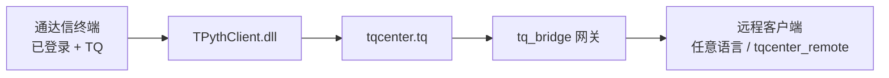

# 通达信背景知识

`tq-bridge` 建立在通达信 **TdxQuant（TQ）** 本机能力之上。了解官方终端、`tqcenter` 与帮助文档，有助于正确部署网关、对齐接口语义。

## 通达信是什么

[通达信](https://www.tdx.com.cn/)（深圳市财富趋势科技股份有限公司）提供证券行情分析与交易类终端。量化侧产品名为 **TdxQuant**：在已登录、支持 TQ 的通达信客户端上，通过 Python（`tqcenter`）或本机 HTTP 调用行情、财务、板块、交易等接口。

本仓库中的 `tq_bridge` **不替代**通达信客户端：它把本机已初始化的 `tqcenter` 能力以 HTTP / WebSocket 暴露给远程机器。

## 核心概念（与本项目相关）

| 概念 | 说明 |
|------|------|
| 通达信终端 | Windows 客户端；`tqcenter` 模式需预先启动并登录（金融终端 / 专业研究 / 量化模拟 / 期货通等支持 TQ 的版本） |
| `tqcenter` | 依赖客户端的 Python SDK（本机加载 `TPythClient.dll` 等） |
| `tqserver` / TdxAiData | 可不依赖本机客户端的云端数据通道（与 `tq-bridge` 独立，见仓库 `tqserver.py`） |
| `PYPlugins/user` | 客户端安装目录下的插件区；官方要求保留其中的 `tqcenter.py` |
| 盘后数据下载 | 本机模式下，历史 K 线等可取范围受客户端已下载数据影响 |

## 官方文档入口（请优先查阅）

| 资源 | 链接 | 用途 |
|------|------|------|
| 用户红宝书（帮助中心） | [https://help.tdx.com.cn/book.html](https://help.tdx.com.cn/book.html) | 终端功能、公式、各册红宝书与资料下载总入口 |
| 《TdxQuant接口说明文档.pdf》 | [本站在线阅读](./tdxquant-doc) · [官网原链](https://www.tdx.com.cn/products/userdoc/TdxQuant%E6%8E%A5%E5%8F%A3%E8%AF%B4%E6%98%8E%E6%96%87%E6%A1%A3.pdf) | TQ / `tqcenter` API 权威说明（方法、参数、返回值） |
| TdxQuant 在线文档 | [https://help.tdx.com.cn/quant/](https://help.tdx.com.cn/quant/) | 与 PDF 对应的在线版：安装、行情、财务、交易、HTTP 调用等 |
| 红宝书 49 · 通达信 TQ 策略 | [docx 直链](https://www.tdx.com.cn/products/userdoc/%E7%BA%A2%E5%AE%9D%E4%B9%A649-%E9%80%9A%E8%BE%BE%E4%BF%A1TQ%E7%AD%96%E7%95%A5.docx) | TQ 策略侧补充说明（同属红宝书下载区） |
| 官网帮助中心 | [https://help.tdx.com.cn/](https://help.tdx.com.cn/) | 常见问题、功能演示、教学视频等 |

> PDF 与红宝书文件托管在官网 `products/userdoc/`，也可在 [用户红宝书](https://help.tdx.com.cn/book.html) 页面列表中找到同名条目。接口细节以官方 PDF / 在线文档为准；本站 [Python SDK](/api/python-sdk) 仅作远程侧速查与对齐说明。

## 和 tq-bridge 的关系

1. **业务 API 语义**：`get_market_data`、`subscribe_hq` 等方法名与参数遵循官方 TdxQuant / `tqcenter` 约定。
2. **运行前提**：网关所在 Windows 须能本机成功 `tq.initialize(...)`（终端登录、DLL、盘后数据等按官方文档排查）。
3. **本项目额外提供**：跨机器的 [网关协议](/api/gateway-http) 与 [Python 参考客户端](/api/python-sdk)；不修改通达信许可范围，官方 DLL / `tqcenter` 仍遵循通达信条款。

## 建议阅读顺序

1. 打开本站 [TdxQuant 接口文档](./tdxquant-doc) 在线阅读，或从 [用户红宝书](https://help.tdx.com.cn/book.html) 下载同源 PDF
2. 按 [TdxQuant 在线文档 · 安装终端](https://help.tdx.com.cn/quant/docs/markdown/mindoc-1cfsjkbf8f3is/mindoc-1d00kk3jsibbc.html) 完成客户端与数据准备
3. 回到本站 [快速开始](./quick-start) 部署 `tq_bridge`，再按需阅读 [架构](./architecture) / [网关协议](/api/gateway-http)
